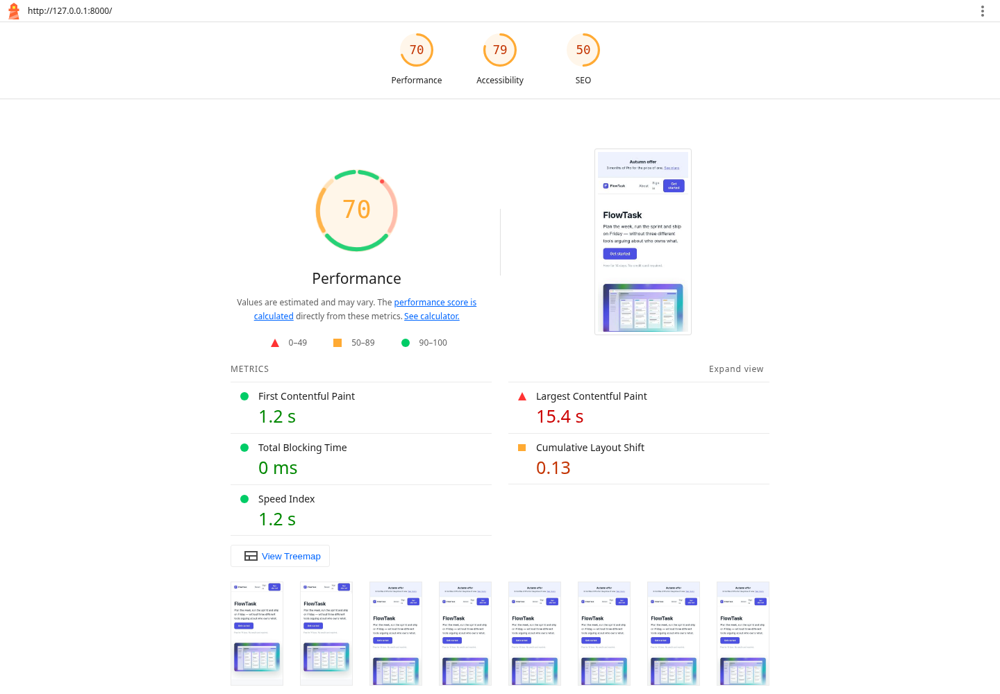
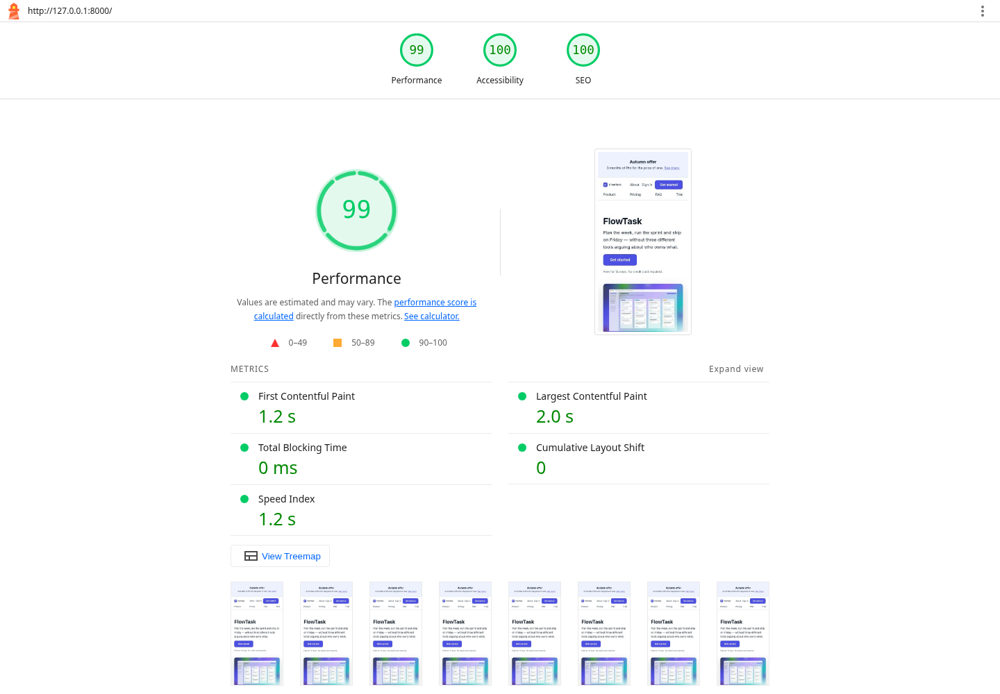
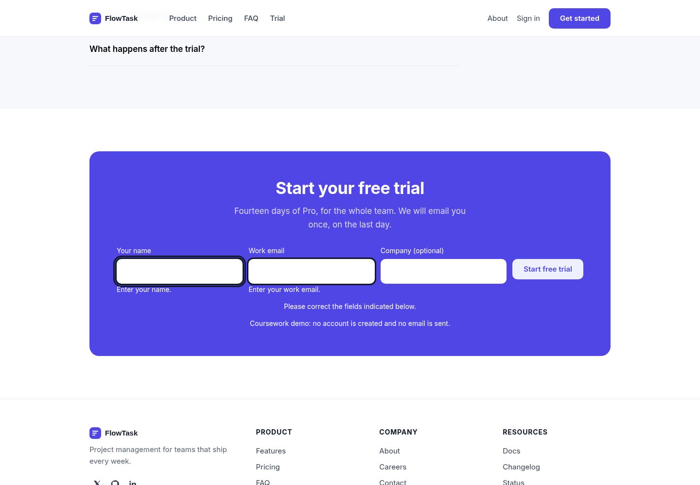
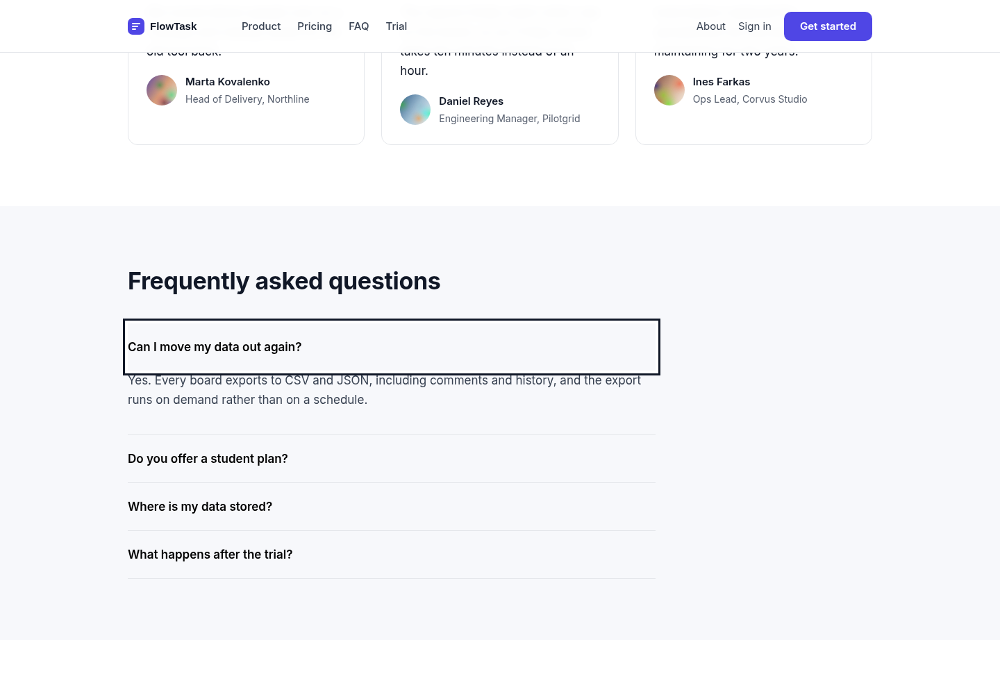

# Звіт до лабораторної роботи №4–5

**Тема:** AI-агент для Web Quality Audit: accessibility, технічне SEO та Core Web Vitals.

**Виконав(ла):** [вписати ПІБ]. **Група:** [вписати групу]. **Дата дослідження:** 15.10.2026.

## 1. Мета, результат і межі виконання

Мета — пройти цикл первинний аудит → AI-рекомендації → перевірка → виправлення → повторний аудит офіційного FlowTask starter, зберігши структуру й дизайн.

Практичний результат: виправлені дві статичні сторінки, 15 успішних функціональних перевірок, початкові та повторні Lighthouse/axe-звіти, CDP Accessibility Tree, профілі CPU, скріншоти сторінок і автоматизованих звітів. Ніякого фреймворку чи збірника у сторінку не додано; Node-пакети використовуються лише для перевірок та копіювання статичних файлів.

**Статус здачі:** локальна реалізація й аудит виконані. Публікація Vercel залишається за студентом відповідно до його вказівки; GitHub Pages ще потрібно активувати й опублікувати. Публічні виміри за §4.7, онлайн-валідатори structured data і ручні скріншоти панелей DevTools не виконані та не підмінені локальними даними. До виконання цих пунктів робота не є повністю готовою до здачі за вимогами викладача.

| Ресурс | Посилання / статус |
|---|---|
| GitHub repository | https://github.com/Byebyeskiy/front-lab-4-5 |
| GitHub Pages | https://byebyeskiy.github.io/front-lab-4-5/ — адреса запланованого деплою, доступність не підтверджено |
| Vercel | **[вставити URL після власного деплою]** |
| Первинний starter | Git-коміт `ca4a46f`, точне походження й SHA256 у `audit/AI-AUDIT.md` |

## 2. Дослідницькі завдання (§4)

### 2.1. WCAG 2.2

WCAG спирається на чотири принципи: Perceivable (сприйнятність: alt, контраст), Operable (керованість: клавіатура, focus), Understandable (зрозумілість: labels і помилки), Robust (надійність: нативна семантика та доступні стани). Success Criterion — перевірювана умова, а не загальна порада; рівень AA вимагає всіх застосовних A та AA, AAA додає суворіші умови. Отримані 100 балів Lighthouse не засвідчують відповідність усім WCAG.

Звичайний текст: мінімум 4,5:1; великий (від 24px або приблизно 18,67px bold): 3:1. Для значущих меж/станів UI за 1.4.11 — 3:1. Target Size 2.5.8 (AA) — 24×24 CSS px **або застосовний виняток**, зокрема достатній інтервал між цілями; це не абсолютна вимога для кожного inline-посилання.

Нові критерії WCAG 2.2: 2.4.11 Focus Not Obscured (Minimum, AA), 2.4.12 Focus Not Obscured (Enhanced, AAA), 2.4.13 Focus Appearance (AAA), 2.5.7 Dragging Movements (AA), 2.5.8 Target Size (Minimum, AA), 3.2.6 Consistent Help (A), 3.3.7 Redundant Entry (A), 3.3.8 Accessible Authentication (Minimum, AA), 3.3.9 Accessible Authentication (Enhanced, AAA). 4.1.1 Parsing вилучено як застарілий; валідна HTML-структура все одно потрібна для семантики й поведінки.

Застосовані критерії: 1.1.1 (hero alt), 1.3.1 (заголовки й labels), 1.4.3 (контраст), 2.1.1 (клавіатура), 2.4.1 (skip link), 2.4.2 (унікальний title), 2.4.7 (видимий focus), 2.4.11 (focus не перекритий sticky header), 2.5.8 (соціальні іконки), 3.1.1 (lang), 3.3.1/3.3.2 (помилки/підписи), 4.1.2 (стан FAQ), 4.1.3 (повідомлення форми). Порушення h1→h4 є підтвердженою проблемою структури, але саме по собі не доводить автоматично невідповідність кожному критерію WCAG.

### 2.2. Chrome Accessibility Tree і клавіатура

Accessibility Tree є похідним від DOM і computed styles; декоративні та приховані вузли можуть не входити до нього. Role, Name, focusable, expanded браузер обчислює з HTML/ARIA, а не з вигляду елемента. Source Order Viewer допомагає зіставити DOM-порядок з візуальним розташуванням; для цього дослідження збережено реальний порядок Tab у JSON. Ручний Source Order Viewer ще потрібно показати на захисті.

Експеримент через Chrome DevTools Protocol (той самий browser accessibility backend; **не ручна робота в UI DevTools**):

| Елемент | До | Після |
|---|---|---|
| Hero Get started | div не має ролі button і не потрапляє до Tab | button, Name=Get started з видимого тексту, focusable=true |
| Why FlowTask? | Role=heading, Name=Why FlowTask?, level=4 | ті самі Role/Name, level=2; розмір стилем збережено |
| Перше FAQ | Role=button, expanded=true при прихованій відповіді | expanded=false спочатку; Enter відкриває, Space закриває |

У початковій сторінці до submit 19 переходів Tab: nav і hero пропущено, outline=none. Після — 25 переходів із skip link, nav та hero; видимий outline на кожному кроці. Порядок: skip → promo → nav → header actions → hero → feature links → pricing → FAQ → name/email/company → submit. Позитивний tabindex не використовується. Окремі перевірки охоплюють Space на hero і Enter у формі.

### 2.3. Автоматичний accessibility audit

`axe-core 4.14.0`: violations означає підтверджене правилом порушення, passes — успішні перевірки, incomplete — випадки, де потрібен додатковий розгляд. На desktop до: 7 типів порушень / 28 входжень на головній, 3 типи / 6 входжень на About. Після: 0 violations, 0 incomplete на обох сторінках у цьому запуску; 0 violations також на ширинах 320, 390, 768 і 1440 px.

Два приклади підтвердження інструмента: `image-alt` прямо вказує на `` без alt; `html-has-lang` — на `<html>` без мови. CDP/DOM підтверджують обидва. Контраст axe знаходив на 18 вузлах головної та 4 About. Нижче наведені окремо обчислені за WCAG sRGB ratios, без округлення до «на око».

Приклад поза автоматичним результатом: валідний `aria-expanded="true"` не відповідає CSS `display:none`; axe не повідомляє цю розбіжність. Аналогічно сканер не визначає достовірність рейтингу 4.9/1284 та не доводить правильність опису продукту. Ці проблеми підтверджено зіставленням стану/контенту. Ручна перевірка студентом залишається необхідною.

Lighthouse Accessibility значною мірою використовує axe; це не два незалежні докази й не повне покриття WCAG 2.2. Поведінка з клавіатури, логічність alt і зміст помилок потребують окремих експериментів.

### 2.4. AI як асистент аудиту

AI корисний для зіставлення HTML, CSS, JS і звітів та для пошуку розбіжностей між видимою сторінкою й метаданими. Він може дати хибну пораду: додати ARIA всюди, перетворити div лише через role або lazy-load усі картинки. Тому кожен рядок первинного AI-аудиту має доказ і спосіб повторної перевірки. Порада AI не є доказом.

Агент: **OpenAI Codex, сімейство GPT-6**; точний build/API model ID середовище не надає. Дата: **15.10.2026**. Повний промпт, походження starter та первинна таблиця §5.2 зафіксовані окремим комітом до виправлень. Таблиця наведена в додатку A цього звіту.

### 2.5. Structured data і technical SEO

JSON-LD описує реальний вміст сторінки. `@context` визначає словник, `@type` — сутність. FlowTask Pro — вебзастосунок для керування проєктами, тому використано `SoftwareApplication`, категорію `BusinessApplication`, платформу `Web browser` і Offer за 29.00 USD на workspace/month відповідно до видимого Pro. Вигаданий aggregateRating вилучено: на сторінці є три текстові відгуки, а не 1284 оцінки та рейтинг 4.9.

`JSON.parse` і тест зіставлення ціни пройдено. Це **не є онлайн Schema Markup Validator**. Schema Markup Validator перевіряє Schema.org загалом; Rich Results Test — лише типи/умови, підтримані Google для rich results. Відсутність aggregateRating/review може зробити SoftwareApplication непридатним для Google rich result; це не привід вигадувати оцінки й не тотожне синтаксичній помилці Schema.org. Фактичні результати обох онлайн-інструментів потрібно додати після публікації.

### 2.6. Open Graph, robots і sitemap

og:title — назва картки, og:description — короткий опис, og:type — тип об'єкта, og:image — абсолютний URL ілюстрації, og:url — канонічна адреса об'єкта. Додано ці поля на обох сторінках з унікальними описами та відповідним canonical; og:image:alt описує ілюстрацію.

Обраний canonical site: **https://byebyeskiy.github.io/front-lab-4-5/**, origin — **https://byebyeskiy.github.io**. Це стабільна адреса, визначена ім'ям репозиторію, незалежна від майбутньої назви Vercel-проєкту. На Vercel сторінки навмисно канонікалізуються до Pages-копій. Canonical — сигнал для пошуковика, а не перенаправлення чи гарантія індексації. Публікацію canonical адрес ще потрібно підтвердити.

robots керує **crawling**, а noindex — **indexing**, якщо crawler може прочитати сторінку. Disallow не гарантує вилучення URL з індексу й може завадити побачити noindex. Знято блокування /css/ і /img/, збережено /admin/, додано Sitemap. Правила Allow/Disallow застосовуються до URL-шляху від кореня origin.

`sitemap.xml` має urlset/url/loc, два абсолютні canonical URL одного origin; lastmod свідомо не додано, щоб не вигадувати дату останньої зміни. На project Pages файл `/front-lab-4-5/robots.txt` є звичайним файлом: crawler шукає **/robots.txt** origin, а не файл у підкаталозі. Перевірку HTTP /robots.txt потрібно зробити саме на Vercel.

Оскільки canonical обрано на GitHub Pages, Vercel robots посилається на **Pages sitemap**; це зовнішній sitemap для Vercel origin. Самої директиви недостатньо для підтвердження cross-site ownership у Google: без відповідних підтверджень його не слід трактувати як автоматично прийнятий sitemap Vercel. Для канонічних Pages URL sitemap подають у Search Console відповідної властивості. У цій роботі перевірено локально синтаксис/URL; публічне прийняття sitemap пошуковиком не перевірялося.

### 2.7. Core Web Vitals

Польові пороги good на 75-му перцентилі: LCP ≤2,5 с; INP ≤200 мс; CLS ≤0,1. Lab-дані — контрольований експеримент, CrUX — агреговані реальні користувачі. Для нового навчального проєкту польові дані не отримано.

Navigation Lighthouse **не вимірює польовий INP**. TBT описує блокування під час завантаження й не виявляє повільний майбутній click handler. У starter TBT=0, хоча CTA блокує близько 300 мс. Browser audit вимірює синхронну тривалість обробника; CPU profile показує обчислення всередині startSignup. Ця тривалість не включає весь input delay/presentation delay, тому не називається INP. Збережений Chrome trace після зміни можна імпортувати у DevTools Performance.

LCP-елемент в обох mobile Lighthouse звітах — `img.hero__image` (див. lcp-breakdown-insight); це не висновок тільки з розміру картинки. JPEG 4000×2500 (2 782 688 байтів) замінено WebP: 640px — 8 634 байти, 1200px — 26 122 байти. Розміри width/height резервують місце, srcset/sizes дають вибір ресурсу, fetchpriority=high допомагає пріоритету. LCP не lazy-loaded. Початковий JPEG залишено в Git для порівняння, але він не завантажується сторінкою й не входить у production export.

Основна причина CLS — банер, який додавався через 800 мс після load; додаткова — відсутність розмірів hero. Той самий банер тепер існує у початковому HTML, а не видалений заради оцінки. Font-display:swap покращує доступність тексту; дуже малий залишковий CLS можливий через метрики шрифтів.

## 3. Умови й відтворюваність вимірювань (§4.7, §5.1)

**Важливо:** нижченаведена таблиця є локальним контрольним порівнянням і НЕ заявляється як обов'язкова таблиця публічного Vercel-деплою за §4.7.

Однакова URL для до/після: `http://127.0.0.1:8000/`; один процес статичного Python HTTP server, без dev HMR і без file://. До — оригінальний `ca4a46f`, після — виправлені HTML/CSS/JS. Середовище Linux, Chromium 154.0.8037.57, Lighthouse 13.5.0, Node 24.19.0; окремий чистий тимчасовий browser profile кожного Lighthouse запуску, без розширень (headless CLI, не ручне incognito-вікно). Lighthouse Mobile, simulated Slow 4G: RTT 150 мс, throughput 1638.4 Kbps, CPU ×4, viewport 412×823 CSS px, DPR 1.75. Три послідовні запуски для кожної версії; у таблиці медіани. Сирі configSettings і environment містяться у JSON кожного запуску.

axe/CDP виконано окремо без throttling: desktop 1440×1000, mobile screenshot 390×844. Відокремлений тест responsive охоплює 320/390/768/1440 CSS px. Синхронний click duration — одиничний діагностичний вимір без CPU throttling, не медіана польових взаємодій. Час у сирих JSON — UTC; дата звіту подана за Europe/Kyiv.

## 4. Перевірка рекомендацій AI (§5.3)

| Рекомендація | Підтвердження/експеримент | Джерело | Рішення |
|---|---|---|---|
| Замінити div навігації/CTA нативними елементами | Tab пропускав div; після посилання й button доступні; Space активує CTA | [1], [16] | Прийнято; role/tabindex для імітації не додавали |
| Синхронізувати aria-expanded і hidden | До true/hidden, після false/hidden → true/visible → false/hidden | [17] APG Disclosure | Прийнято; aria-controls пов'язує конкретну відповідь |
| Додати labels та зрозумілі помилки | Порожня/невалідна/валідна форма, фокус на першій помилці, Enter-submit | [1], [18] | Прийнято; aria-invalid лише при помилці, describedby для пояснення |
| Поліпшити muted/soft contrast | axe color-contrast; числовий contrast ratio; повторний axe на 4 ширинах | [1] 1.4.3 | Прийнято; дизайн і палітра збережені, змінилася світлість тексту |
| Прибрати вигаданий aggregateRating і виправити $19 на $29 | Видимий Pro=$29, оцінки 4.9/1284 відсутні; JSON-LD assertions | [7], [19] | Прийнято; валідний JSON сам по собі не доводить правдивість |
| Розблокувати CSS/зображення у robots | Початкові Disallow заважали рендерингу crawler; новий HTTP content перевірено | [11] | Прийнято; root-origin перевірка відкладена до Vercel |
| Оптимізувати hero, не lazy-load LCP | Lighthouse визначає hero як LCP, надмірний JPEG, після 3 повтори | [13], [20] | Прийнято; responsive WebP та eager default |
| «Додати alt із іменами до всіх аватарів і опис до всіх іконок» | Імена авторів уже поруч, іконки лише повторюють зміст заголовків | [21] WAI decorative images | **Відхилено**: порожній alt правильний для декору, інакше буде дублювання |
| «Додати role=button/tabindex до hero div та aria-label до всіх кнопок» | Нативний button уже дає Role, Name, Space/Enter; загальна aria-label може замінити видимий текст | [16], [22] | **Відхилено**: HTML-семантика достатня, зайва ARIA не потрібна |
| «Lazy-load усі картинки, включно з hero» | Hero є LCP, lazy відкладає запит ресурсу | [20] | **Відхилено** для hero; це суперечить цілі оптимізації LCP |

Відхилені пункти — кандидати, явно розглянуті AI на етапі первинного аудиту; вони ніколи не застосовувалися до коду. Пряме завантаження більшості сайтів документації у cloud повертає proxy 403; джерела наведено для самостійної перевірки. Для Disclosure прочитано офіційний вихідний текст APG через GitHub: він прямо вимагає true для видимого контенту та false для прихованого. Не заявляється, що студент особисто відкрив кожне джерело або DevTools.

## 5. Опис змін (§5.4)

- Обидві сторінки: lang=en; унікальні title/description; canonical та повний OG; defer; skip link; нативні nav links; focus; статичний промобанер; робочі внутрішні посилання.
- Головна: h2 замість h4 при збереженні розміру; alt, розміри й WebP hero; декоративним іконкам лишено alt=""; FAQ hidden/expanded/controls; підписи форми, autocomplete, перевірка required/email, текст помилки, focus на невалідному полі, status для успіху/помилок.
- Контраст muted/soft підсилено; icon-only посилання мають назви і цілі 32×32; на вузьких екранах header переноситься й навігація доступна.
- JSON-LD тепер описує фактичний Pro, без вигаданих рейтингів; noindex прибрано; ресурси дозволено в robots; sitemap має дві canonical сторінки.
- Busy loop ~300 мс вилучено: його обчислення не використовувались. Миттєве фокусування trial замінює беззмістовну затримку.
- В About узгоджено твердження про підтримку з видимими планами (початкове «немає тарифу зі швидшою відповіддю» суперечило Priority/24/7 support). Недоступні Sign in/Careers/Docs/соцмережі ведуть до чесного пояснення демо, а не до вигаданих облікових записів. Форма не обіцяє надіслати лист без бекенду.
- Додано відтворювані інструменти, VS Code tasks/debug, безпечний статичний export, Pages workflow та Vercel config. У production потрапляють лише файли сайту; звіт, CPU profiles і node_modules не публікуються.

## 6. Повторний аудит і таблиця до/після (§5.5)

Медіани трьох локальних Lighthouse запусків; деталі умов — розділ 3. Значення не є польовими CrUX і не є аудитом публічного Vercel.

| Перевірка | До | Після |
|---|---|---|
| Accessibility: поведінка browser/CDP | Nav/hero поза Tab, outline=none, хибний FAQ expanded, submit div | Доступні Tab/Space/Enter, видимий focus, коректний FAQ, нативний submit; ручне DevTools студентом ще потрібне |
| Lighthouse Accessibility | 79 | 100; не гарантує повного WCAG conformance |
| axe desktop index / About | 7 типів (28 входжень) / 3 типи (6 входжень) | 0 / 0; incomplete 0 / 0 у цьому запуску |
| Lighthouse Performance | 70 | 99 |
| LCP | 15,378 с; hero JPEG | 1,954 с; той самий hero у WebP |
| CLS | 0,130062; пізній банер/розміри hero | 0,000486; зарезервовано layout, мінімальні зміни шрифту |
| TBT | 0 мс | 0 мс; не відображає майбутні clicks |
| FCP | 1,203 с | 1,205 с; суттєвого виграшу не зафіксовано |
| Speed Index | 1,203 с | 1,205 с; практично без змін |
| Синхронний CTA handler, без throttling | ~300,4 мс | ~0,9 мс; це НЕ INP |
| Performance diagnostics | Hero 2,8 MB, unsized image, dynamic promo, blocking JS | Hero 8,6/26,1 KB, задані розміри, static promo, defer; залишилися CSS/cache/avatar diagnostics |
| Technical SEO | Lighthouse 50; noindex, відсутні метадані/OG/canonical/sitemap, хибний JSON-LD | Lighthouse 100; локальні DOM/HTTP assertions успішні; online validators і публічний root robots ще потрібні |
| Mobile overflow 390px | scrollWidth=395px | scrollWidth=390px; також пройдено 320/768/1440px |
| Функціональні перевірки | окремої suite у starter немає | 15 перевірок виконано й пройдено; не нульовий запуск |

Сирі результати: `audit/evidence/{before,after}/lighthouse-{1,2,3}.report.json` і HTML; `summary.json`, `axe-index.json`, `axe-about.json`, `ax-index.json`, `ax-about.json`, `signup-cpu-profile.json`. `audit/evidence/after/tests.json` містить 15 назв перевірок і timestamp. Додатковий `signup-trace.json` можна відкрити в Chrome Performance. Машинні медіани — `audit/evidence/metrics.json`.

### Скріншоти фактичних результатів

Lighthouse до (реальний HTML-звіт першого запуску):

Lighthouse після (перший запуск; таблиця вище використовує медіани):

Текстові помилки форми після порожнього submit:

FAQ після Enter з видимим focus:

Повні desktop/mobile скріншоти обох версій розміщені в `audit/evidence/before` та `after` (`index-desktop.png`, `index-mobile.png`, `about-desktop.png`). Це скріншоти сторінок/звітів, **не підроблені знімки панелей DevTools**. Ручні панелі Accessibility та Performance потрібно додати студенту за інструкцією нижче.

## 7. Залишені проблеми, хибні рекомендації та обмеження

Lighthouse залишає рекомендації щодо кешування/стиснення (локальний Python server не моделює CDN), блокувального CSS, немініфікованого/невикористаного shared UI kit і завеликих аватарів (~81 KiB потенційної економії). Це не приховано й не «виправлено» видаленням секцій. Для невеликого навчального сайту головний виміряний bottleneck усунуто; додаткова мініфікація не вимагалася й погіршила б читабельність навчального CSS. Аватари можна оптимізувати окремо, вони не LCP. Кешування CDN потрібно повторно перевірити на Vercel; локальний результат нічого не доводить про production headers.

Порожні alt декоративних елементів — не дефект. Відсутність рейтингів заради Google rich result — не причина вигадати дані. Низький TBT не означає швидкий CTA; високий бал axe не перевіряє правдивість aria-expanded. Сканери не можуть автоматично підтвердити повний WCAG AA, а keyboard/CDP експерименти агента не замінюють усний захист і ручні дії студента.

INP/CrUX не отримано. Віддалені публікації, реальна індексація, Search Console і онлайн Schema/Rich Results не перевірені. Vercel-публікацію користувач узяв на себе. Ці обмеження не приховані нулями або вигаданими «100» у звіті.

## 8. Що завершити після Vercel-публікації

1. Заповнити ПІБ/групу й Vercel URL у звіті та листі. GitHub Pages Settings → Pages → Source: GitHub Actions; push коду на main запускає наданий workflow. Vercel: імпортувати репозиторій, Root Directory — корінь, Framework — Other; `vercel.json` задає npm ci, статичне копіювання й output `artifacts/site`.
2. Для обов'язкового публічного «до/після» не втрачено starter: `node tools/prepare-site.mjs --baseline` експортує оригінал у artifacts/site, не змінюючи checkout. На Vercel спочатку опублікувати цей export на **одній production URL**, виконати 3 mobile runs; потім опублікувати виправлений export на тій самій URL й повторити. Звичайний деплой із версійного `vercel.json` публікує виправлену версію; для baseline змінити Build Command у Vercel на `node tools/prepare-site.mjs --baseline`, для after повернути `npm run prepare:site`.
3. Вимірювати в Chrome incognito без розширень, той самий Mobile/Slow 4G, 3 запуски кожної версії; записати Chrome/Lighthouse versions, дату й медіани. Зберегти **окремо** від локальних доказів, наприклад `audit/deployed-evidence/`, щоб не втратити початкові дані. CLI runner теж придатний для повторів, але його headless-умови не називати ручним incognito. Після цього додати другу таблицю «Публічний Vercel до/після».
4. На Vercel відкрити `/robots.txt`, `/sitemap.xml`, `/`, `/about.html`, CSS і hero, перевірити HTTP 200, Content-Type, відсутність auth/noindex headers. На Pages перевірити кожну сторінку та ресурс, відповідність canonical/OG; не називати підкаталоговий robots root-origin robots.
5. Перевірити JSON-LD в Schema Markup Validator та Google Rich Results Test, зберегти скріншоти й пояснити різницю. Не додавати вигадані rating/review заради rich-result eligibility.
6. DevTools → Elements → Accessibility: screenshot hero button (Role/Name) і Why FlowTask heading (level=2). Для FAQ показати expanded=false/true; пройти Tab від початку до submit, перевірити focus під sticky header та на zoom 200%/400%.
7. DevTools → Performance: записати click Get started, показати event/довгу задачу до і після; збережені CPU profiles допоможуть пояснити причину. Не називати click duration польовим INP. Зробити screenshot LCP element та LayoutShift sources. Додати ручні висновки з Source Order Viewer і скріншоти до звіту.
8. Оновити коміт зі звітом після цих перевірок. Лист із EMAIL.md — шаблон, він не надісланий автоматично.

## 9. Висновок

У локальному контрольованому експерименті усунуто підтверджені проблеми accessibility, technical SEO та ключові performance bottlenecks. Структуру landing page збережено, кожна зміна має вихідний доказ і повторну перевірку. Найбільший ефект дала оптимізація hero й стабілізація layout; FCP майже не змінився, а TBT не міг показати дефект click handler. Відхилено зайві ARIA, декоративні alt та lazy-loading LCP за документацією. Завершення навчальної роботи потребує власного Vercel-деплою, публічного порівняння й ручних доказів DevTools, перелічених вище.

## 10. Джерела

1. [WCAG 2.2 — W3C](https://www.w3.org/TR/WCAG22/)
2. [WCAG at a Glance](https://www.w3.org/WAI/standards-guidelines/wcag/glance/)
3. [What's New in WCAG 2.2](https://www.w3.org/WAI/standards-guidelines/wcag/new-in-22/)
4. [Chrome DevTools Accessibility reference](https://developer.chrome.com/docs/devtools/accessibility/reference)
5. [Lighthouse](https://developer.chrome.com/docs/lighthouse/)
6. [axe-core](https://github.com/dequelabs/axe-core)
7. [Google structured data introduction](https://developers.google.com/search/docs/appearance/structured-data/intro-structured-data)
8. [Schema Markup Validator](https://validator.schema.org/)
9. [Google Rich Results Test](https://search.google.com/test/rich-results)
10. [Open Graph protocol](https://ogp.me/)
11. [Google robots.txt introduction](https://developers.google.com/search/docs/crawling-indexing/robots/intro)
12. [Build and submit a sitemap](https://developers.google.com/search/docs/crawling-indexing/sitemaps/build-sitemap)
13. [Web Vitals](https://web.dev/articles/vitals)
14. [Core Web Vitals workflows](https://web.dev/articles/vitals-tools)
15. [INP](https://web.dev/articles/inp)
16. [APG button pattern](https://www.w3.org/WAI/ARIA/apg/patterns/button/)
17. [APG disclosure pattern](https://www.w3.org/WAI/ARIA/apg/patterns/disclosure/) — також [офіційний вихідний текст](https://github.com/w3c/aria-practices/blob/main/content/patterns/disclosure/disclosure-pattern.html)
18. [WAI form notifications](https://www.w3.org/WAI/tutorials/forms/notifications/)
19. [Structured data general guidelines](https://developers.google.com/search/docs/appearance/structured-data/sd-policies)
20. [Optimize LCP](https://web.dev/articles/optimize-lcp)
21. [WAI decorative images](https://www.w3.org/WAI/tutorials/images/decorative/)
22. [First rule of ARIA](https://www.w3.org/TR/using-aria/#rule1)
23. [Офіційний starter і навчальна робота](https://github.com/denysmatsevych/web-development-2026)

## Додаток A. Початковий AI audit report (§5.2)

### Первинний AI-аудит FlowTask (§5.2)

Дата: 15.10.2026. Агент: OpenAI Codex, сімейство GPT-6; точний номер збірки/API model ID інтерфейс не надає. Не підмінювати його вигаданою версією.

Промпт: «Проаналізуй офіційний FlowTask starter, HTML, CSS, JS, початкові axe/Lighthouse і Chrome Accessibility Tree. Спочатку сформуй таблицю Category / Problem / Evidence / Severity / Recommendation / Verification. Не змінюй дизайн; виправляй лише підтверджене. Перевір щонайменше 5 рекомендацій і відхили хоча б одну з посиланням на джерело. Не вигадуй польові INP, деплої чи результати ручного DevTools».

Джерело: офіційний архів `public/labs/flowtask-starter.zip` з GitHub `denysmatsevych/web-development-2026`, коміт `306900f5b11efe6096ccbbbfee44da071f8f7f06`. SHA256 архіву: `eb0080c8775cc16d8b11e09613fd5e80e9d0718d248e91a3f83612fe6fa0f1db`. Прямий URL курсу недоступний через мережевий proxy (403), тому використано той самий архів з офіційного Git-репозиторію. Список прихованих дефектів не використовувався.

Початковий код збережено комітом `ca4a46f`. Результати: `evidence/before/`. Перевірки тут локальні, а не обов'язковий за ТЗ аудит Vercel. Користувач виконає публікацію Vercel самостійно.

| Category | Problem | Evidence | Severity | Recommendation | Verification |
|---|---|---|---|---|---|
| Accessibility | Немає мови документа | Обидва `<html>` без lang; axe html-has-lang | Висока | lang="en" відповідно до контенту | axe + DOM |
| Accessibility | Nav — div, hero CTA — div, submit лише click | Tab пропускає навігацію і hero; div submit не активується Space/Enter як button | Висока | Посилання для переходів, нативний submit | Реальні Tab/Enter/Space |
| Accessibility | Вимкнений focus | `:focus { outline:none }`, журнал Tab outline=none | Висока | Контрастний focus, scroll-margin для sticky header, skip link | Tab + скріншоти |
| Accessibility | Некоректна ієрархія | h1 → h4 → h3; axe heading-order | Середня | h2 зі збереженням розміру | DOM + AX |
| Accessibility | Hero без alt | axe image-alt, зображення показує task board | Висока | Змістовний alt і розміри | axe + AX |
| Accessibility | Слабкий контраст | axe color-contrast: 18 елементів головної, 4 About | Висока | Затемнити muted/soft; контраст placeholders і focus | axe + числові ratios |
| Accessibility | Іконки соцмереж без назв, малі цілі | axe link-name (3), target-size (3) | Висока | Назви лише icon-only controls; цілі ≥24px | axe + вимірювання |
| Accessibility | Placeholder замість постійних labels, помилка лише кольором | input без label; порожній email отримує тільки boxShadow | Висока | Видимі labels, required/type=email, текст помилки, aria-describedby/invalid | Порожнє, невалідне, валідне введення |
| Accessibility | FAQ повідомляє протилежний стан | Browser audit: expanded=true, visible=false; axe це не виявив | Висока | Синхронізувати hidden та aria-expanded; aria-controls | AX і Enter/Space |
| Accessibility/SEO | Неробочі фрагменти та заглушки | #pricing-details без id; About nav без targets; href="#" | Середня | Чинні локальні посилання; чесно позначити відсутні demo destinations | Перевірка всіх фрагментів |
| SEO | noindex на головній | meta robots=noindex | Висока | Прибрати для сторінки, призначеної до індексації | DOM + Lighthouse |
| SEO | Немає description, canonical, OG; однакові titles | DOM обох сторінок, Lighthouse | Середня | Унікальні метадані, один canonical origin, absolute OG image | DOM assertions |
| SEO | JSON-LD суперечить видимому контенту | Pro $19 у JSON проти $29 на сторінці; 4.9/1284 немає у контенті | Висока | SoftwareApplication, $29 USD, без непідтвердженого rating | Зіставити JSON-LD з pricing; онлайн validators після деплою |
| SEO | Robots блокує ресурси, sitemap відсутній | Disallow /css/, /img/; GET sitemap.xml =404 | Висока | Дозволити ресурси, додати sitemap з обома canonical URL | HTTP/XML + Vercel /robots.txt після публікації |
| Performance | Надмірний hero JPEG | 4000×2500, 2 782 688 байтів; LCP IMG.hero__image | Висока | Responsive WebP, width/height, fetchpriority=high; не lazy-load LCP | Network + Lighthouse 3 runs |
| Performance | Promo зсуває layout | JS вставляє банер через 800ms; LayoutShift sources і Lighthouse CLS | Висока | Той самий банер у початковому HTML обох сторінок | PerformanceObserver shifts |
| Performance | Busy loop у CTA | CPU profile; dispatch click ~300ms; результат total не використовується | Висока | Прибрати непотрібну синхронну роботу | CPU profile та click duration; не називати INP |
| Performance | Блокувальний JS, font без display | script у head без defer; @font-face без font-display | Середня | defer, font-display:swap | DOM + network/render перевірка |
| Кандидат AI, ВІДХИЛЕНО | «Заповнити всі порожні alt; hero зробити lazy» | Порожні alt у декоративних іконок/аватарів правильні: імена вже поруч. Hero — LCP | — | Залишити декоративним alt="", для hero не використовувати lazy | WAI decorative images; web.dev optimize-lcp |
| Кандидат AI, ВІДХИЛЕНО | «Додати role=button і tabindex до hero div, aria-label усім кнопкам» | Додає ручну імітацію клавіатури і перезаписує текстову назву | — | Нативний link/button, name з видимого тексту | WAI first rule of ARIA; APG button |

Фіксується до внесення змін до коду сторінок. Browser/CDP експерименти не видаються за ручне відкриття панелі DevTools студентом. Публічний аудит та ручні скріншоти панелей залишаються етапом після деплою.

## Додаток B. Числовий контраст

Обчислено з sRGB за формулою відносної яскравості WCAG. Перевірка axe додатково враховує фактично відрендерені елементи.

| Колір тексту | Фон | Ratio | Висновок для звичайного тексту |
|---|---|---|---|
| #939ba7 | #ffffff | 2.80:1 | AA не пройдено |
| #939ba7 | #f7f8fb | 2.64:1 | AA не пройдено |
| #717985 | #ffffff | 4.40:1 | AA не пройдено |
| #596170 | #ffffff | 6.23:1 | AA пройдено |
| #596170 | #f7f8fb | 5.87:1 | AA пройдено |
| #4f46e5 | #ffffff | 6.29:1 | AA пройдено |
